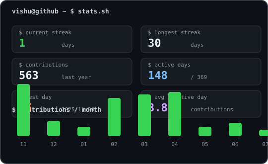

<h3><code>vishu@github ~ $ ./contributions.sh</code></h3>

  

<h3><code>vishu@github ~ $ whoami</code></h3>
<table>
  <tr>
    <!-- Add the optional portrait here after running the local portrait scripts:
    <td valign="top"></td>
    -->
    <td valign="top"></td>
    <td valign="top"></td>
  </tr>
</table>

 

<h3><code>vishu@github ~ $ cat links.txt</code></h3>
<a href="https://www.linkedin.com/in/vishu-kush-293a0432a/">LinkedIn</a> ·
<a href="https://leetcode.com/u/vishu___00/">LeetCode</a> ·
<a href="https://codeforces.com/profile/vishu__00">Codeforces</a>

